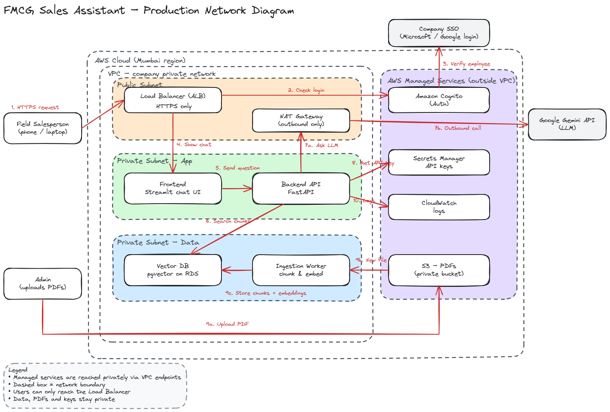
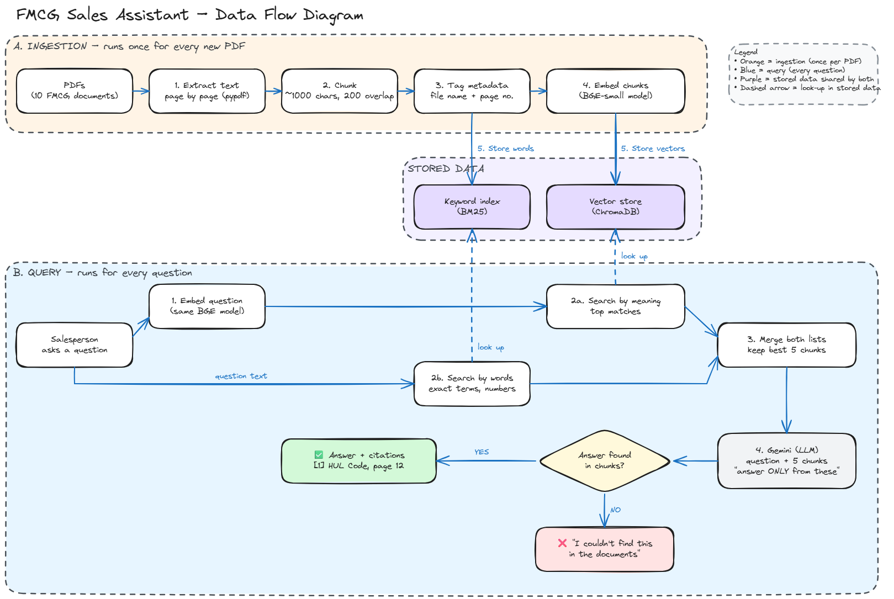

# FMCG Sales Assistant

An assistant for an FMCG company's field sales team. Salespeople ask questions in plain English, and it answers from the company's documents (product catalogues, scheme circulars, policies) and shows the PDF and page each answer came from. If the answer isn't in the documents, it says so instead of guessing.

Built for the Futurelab Studios take-home task by Rukmini S.

**Demo:** [3-minute screen recording](https://drive.google.com/file/d/1SrxqKgciC49nAIGDew2DRt57cEQxNkZc/view?usp=sharing)

---

## Diagrams

**Production network diagram:** how I would deploy this for a real company on AWS.



**Data flow diagram:** how a PDF becomes searchable (ingestion) and how a question becomes an answer with citations (query).



The editable Excalidraw files are in `docs/`.

---

## How to run it

You need Python 3.10+ and a free Gemini API key from [Google AI Studio](https://aistudio.google.com).

```bash
pip install -r requirements.txt
cp .env.example .env          # then paste your Gemini key into .env
python ingest.py              # reads the PDFs in data/ and builds the index
streamlit run app.py          # opens the chat app in your browser
python evaluate.py            # runs the 10 test questions -> eval/results.md
```

The first run of `ingest.py` downloads the embedding model (about 130 MB).

## Project structure

| File | What it does |
|---|---|
| `config.py` | All settings in one place (chunk size, overlap, top-k, model names) |
| `ingest.py` | Ingestion: PDF → text per page → chunks → metadata → embeddings → ChromaDB + keyword index |
| `rag.py` | Query: hybrid search → merge → Gemini (answer only from sources) → answer with citations |
| `app.py` | Streamlit chat app with clickable sources |
| `evaluate.py` | Runs the test questions in `eval/questions.json` and saves the results |
| `data/` | The 10 PDFs used as stand-in documents |
| `docs/` | Both diagrams |

I split the code the same way as the data flow diagram: one file for ingestion, one for answering, so each file has one job.

---

## Key design choices

| Part | What I chose | Why |
|---|---|---|
| **Chunking** | ~1,000 characters per chunk, 200 characters of overlap, split per page | Big enough to hold one full idea, small enough for precise search. The overlap keeps sentences on a boundary from being lost, and splitting per page keeps exact page numbers for citations. |
| **Embeddings** | `BAAI/bge-small-en-v1.5` (via fastembed), runs locally | Free, good for English, and no API limits while indexing. Each chunk becomes 384 numbers that capture its meaning. |
| **Vector store** | ChromaDB | Simple and free, saves to a local folder. In production I'd use pgvector on RDS, as in the network diagram. |
| **Retrieval** | Hybrid: meaning search + BM25 keyword search, merged with Reciprocal Rank Fusion, top 5 chunks | Meaning search handles everyday wording ("presents" ≈ "gifts"). Keyword search catches exact terms like brand names and periods ("Plix", "Q2 FY2026"). Merging gives the best of both. |
| **Generation** | Gemini (`gemini-flash-latest`, with `gemini-flash-lite-latest` as backup), temperature 0.1 | The prompt says: answer only from the sources, cite them like [1], quote numbers exactly, and say "I couldn't find this in the documents" if the answer isn't there. For a sales team, a made-up price is worse than no answer. |

**Handling the free Gemini API:** while building, a model name was retired and the main model was often overloaded. So the app retries a busy model with short waits, then switches to the backup model, and shows which model answered. I kept Gemini's default thinking level on purpose: a slower but complete answer is better than a fast one that misses a fact.

---

## Documents used

Real FMCG companies don't publish their internal price lists or scheme circulars, so I used public documents as stand-ins: annual reports, results, presentations and policies from the companies' official investor pages and stock exchange filings.

| File | Company | Type |
|---|---|---|
| Marico_Annual_Report_FY25.pdf | Marico | Annual report |
| dabur-mda.pdf | Dabur | Management discussion & analysis |
| dabur-directors-report.pdf | Dabur | Directors' report |
| ITC-Press-Release-Q2-FY2026.pdf | ITC | Quarterly results press release |
| ITC-Financial-Result-Q4-FY2025.pdf | ITC | Financial results (tables) |
| Nestle-Investor-presentation-26.pdf | Nestlé India | Investor presentation |
| Nestle_India_BusinessReport.pdf | Nestlé India | Business responsibility report |
| Nestle-CSR-Policy-2023.pdf | Nestlé India | CSR policy |
| Hul-Code-of-Business-Principles.pdf | HUL | Code of conduct |
| hul-cg-code-of-conduct.pdf | HUL | Corporate governance code |

---

## Test results (10 questions)

I picked questions of different types on purpose: policies, brands, numbers, a table lookup, a question that needs two documents, and two "trick" questions whose answers aren't in any document. The questions are in `eval/questions.json`, and the raw answers are in `eval/results.md` and `eval/results.json`. I read every answer, checked it against the cited page, and marked it myself.

| # | Question | Type | Verdict | Why |
|---|---|---|---|---|
| 1 | Can a salesperson accept gifts or hospitality from a distributor? | Policy | ✅ Right | Complete gift and hospitality rules from the HUL Code (pp. 18–19), all cited |
| 2 | What are Marico's key brands? | Brand | ✅ Right | Full India and international brand lists; I checked them against page 6 |
| 3 | How did ITC's FMCG business perform in Q2 FY2026? | Numbers | ⚠️ Partly | Numbers were exact, but for the whole company, not the FMCG segment. Chunks from the Q4 FY2025 report crowded out the right page |
| 4 | What are the focus areas of Nestlé India's CSR policy? | Policy | ✅ Right | Education, environment, feeding and disaster relief, from the CSR policy |
| 5 | What does Dabur say about rural demand? | Insight | ✅ Right, weak citations | Content was right, but every point cited all five sources, so you can't tell which page says what |
| 6 | What should an employee do if they face a conflict of interest at HUL? | Policy | ✅ Right | Disclose to the Business Integrity Officer and stay out of decisions until cleared (HUL p. 16) |
| 7 | What was ITC's total revenue from operations for the quarter ended March 2025? | Table | ⚠️ Mostly right | 20376.36 is the correct figure from the table (I checked page 1), but the answer didn't say it is consolidated or in ₹ crore |
| 8 | Compare how Dabur and Marico describe their distribution reach. | Multi-document | ⚠️ Partly | Dabur part was right and detailed. For Marico, search brought the wrong pages, and the model honestly said the information wasn't there |
| 9 | What is the price of a 70g Maggi pack? | Trick | ✅ Right | Said it couldn't find it instead of guessing a price |
| 10 | What discount scheme is running for distributors this month? | Trick | ✅ Right | Said it couldn't find it, and didn't confuse it with other "schemes" in the reports |

**Score: 7 right, 3 partly right, 0 wrong.** It never made up a fact. Every weak answer was incomplete, not false.

All 10 were answered by the backup model (gemini-flash-lite-latest), because the main model was overloaded the whole afternoon. I'd expect somewhat more complete answers from the main model.

**What worked well:**
- **Refusing to guess.** Both trick questions got "I couldn't find this", even though search found related chunks (Maggi pages, other "schemes").
- **Policy questions.** The answers were complete, specific and cited, straight from the policy pages.
- **Numbers were always quoted exactly.** I didn't find a single changed number.
- **Long documents.** It found the right pages in a 250-page annual report.

**Where it went wrong, and why:**
- **Mixing up periods (Q3).** Financial reports from different quarters use almost the same words, so search can't tell Q2 FY26 from Q4 FY25. When I restricted search to the Q2 press release using the document filter, the answer included the FMCG segment figures (FMCG-Others up 8%, the growth drivers, a 10% margin). So the data was there; the search picked the wrong pages.
- **Questions about two companies (Q8).** Only five chunks go to the model, and one company can take most of them. The other company's answer then comes from weak or wrong pages.
- **Vague citations and missing units (Q5, Q7).** The backup model sometimes cited every source for every point, or left out units.

**Other things I found while testing (before the final run):**
- **Everyday words.** "Can I take presents from dealers?" first returned "not found", even though search had found the right gift-policy page. The model was too literal about "presents" vs "gifts". I added a prompt rule that everyday words count as the same topic, then re-ran the Maggi question to check that it still refused (it did).
- **Comparing search methods.** For "presents from dealers", keyword-only search failed (it matched "dealers" in sales tables), meaning-only search gave the most complete answer, and hybrid was in between, because the keyword results took some of the five slots. Hybrid is the safest default, but not always the best for every question.
- **Repeated sources.** Overlapping chunks from the same page show up as several sources with the same page number.

---

## What I'd improve with more time

- **Company and period tags:** tag every chunk with company and period (e.g. "ITC, Q2 FY2026"), detect them in the question, and filter on them. The document-filter test shows this would fix the quarter mix-ups.
- **Re-ranking:** add a re-ranker model to re-score the top 20 chunks before picking the best 5, so keyword noise (like the "sales to dealers" tables) gets pushed out.
- **Balanced multi-document answers:** when a question names two companies, retrieve chunks for each company separately.
- **Tables:** financial tables lose their rows and columns when the PDF text is pulled out. I'd use a table-aware parser and store tables as rows, with units.
- **Cleaner sources:** merge overlapping chunks from the same page into one source.
- **Hindi and Kannada:** field staff often prefer regional languages. I'd add translation of questions and answers, for example with Sarvam's Indian-language models.
- **Feedback buttons:** a thumbs up/down on each answer to collect real examples and grow the test set.
- **Production setup:** run it as in the network diagram, on a paid LLM plan (so the main model is available), with SSO login, the API key in Secrets Manager, and new PDFs indexed automatically when uploaded to S3.

## AI tools I used and time taken

- **Claude:** helped me plan the architecture, explained the concepts as I went (chunking, embeddings, hybrid search), wrote and debugged the code with me, drafted the diagrams and helped me analyse the test results.
- **Excalidraw:** finishing the diagrams.
- **Gemini API:** the LLM inside the app.

**Time taken:** about 12–14 hours over three days. That includes learning RAG concepts I hadn't used before, waiting for the embedding model to download on a slow connection, and working around Gemini API outages.
